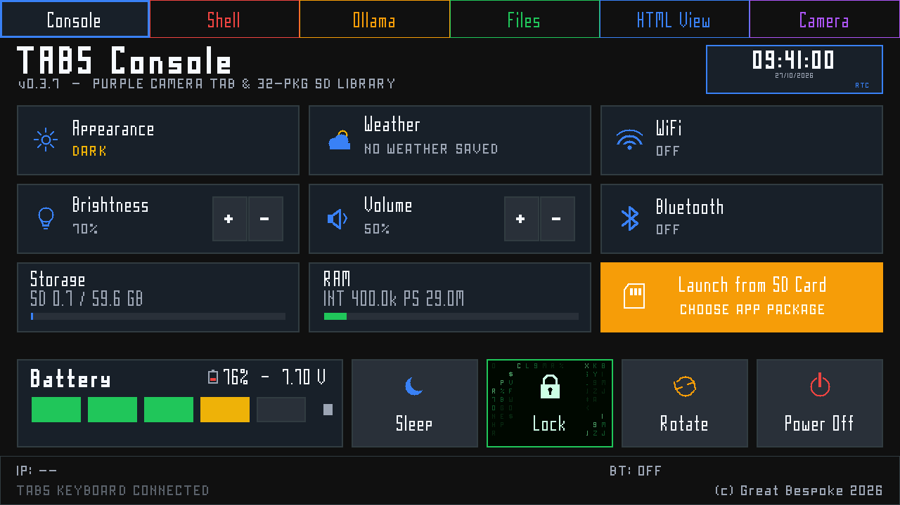
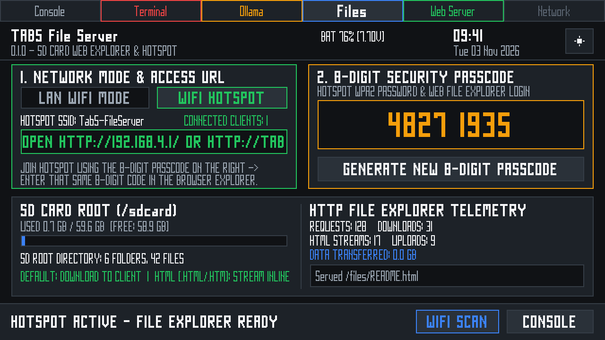
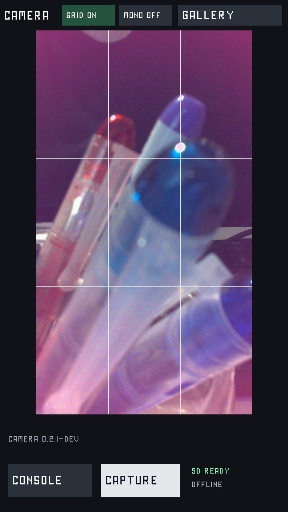
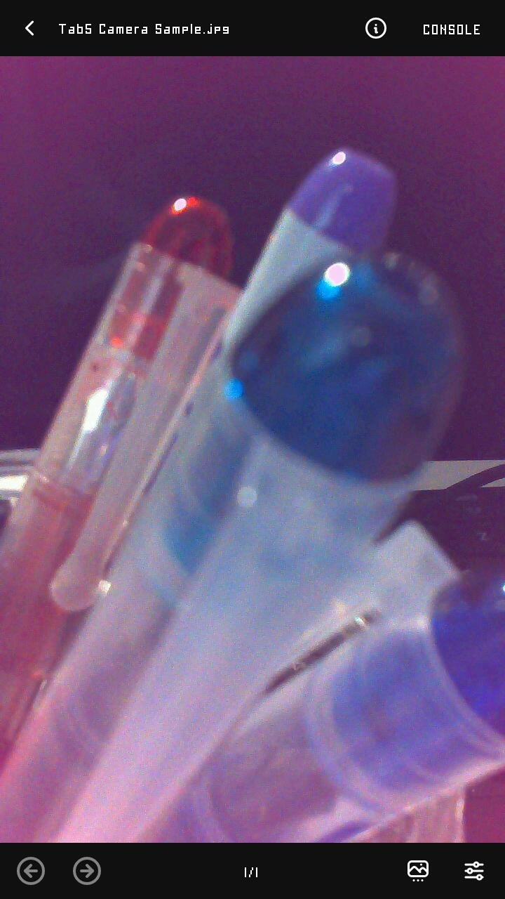
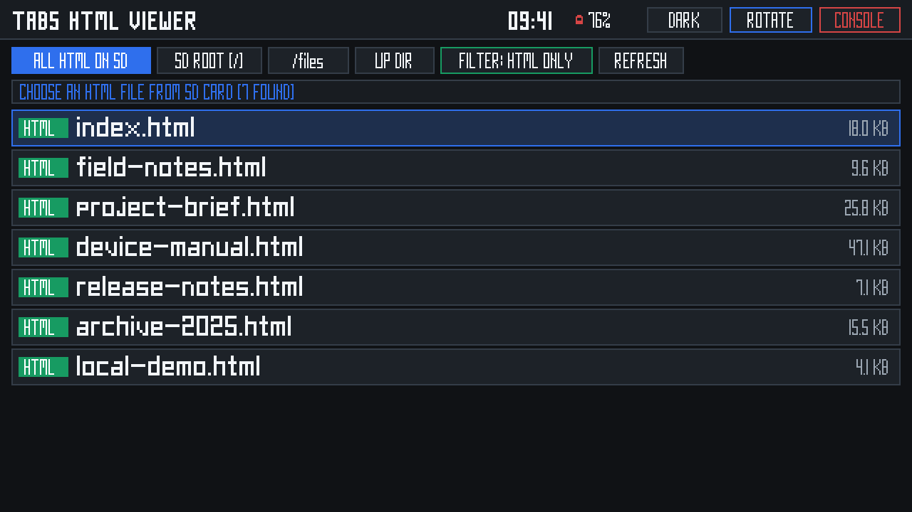
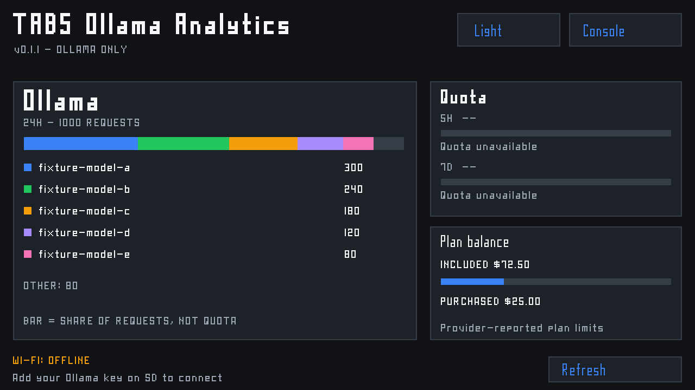
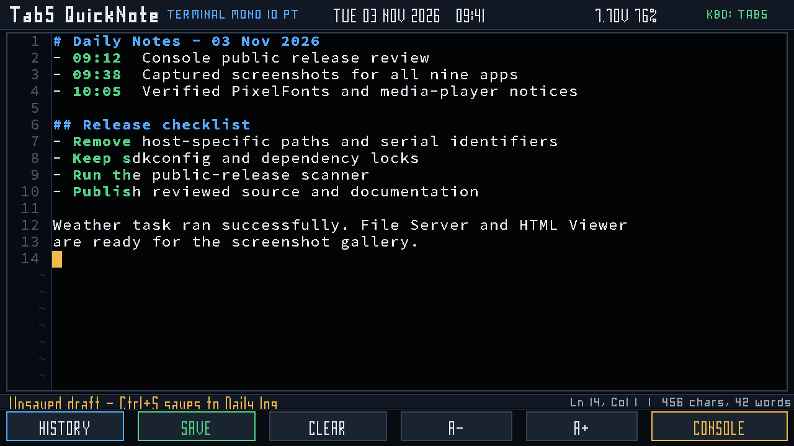
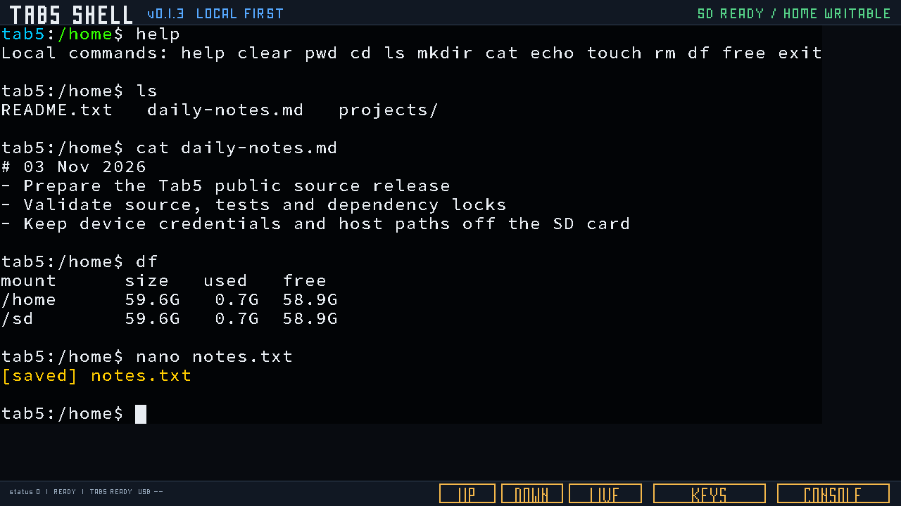
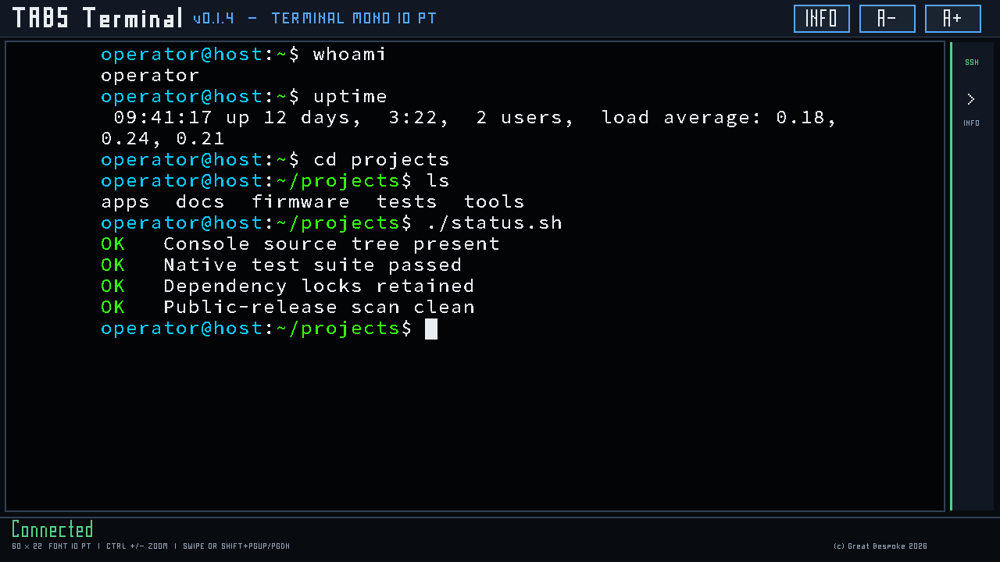
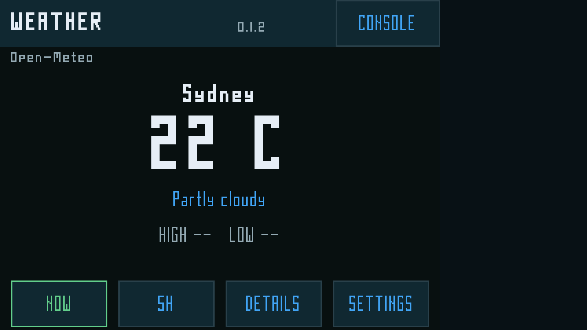

# Great Bespoke Tab5

Public ESP-IDF workspace for the M5Stack Tab5: a resident launcher and a set of
SD-installable applications for the ESP32-P4, ST7121 display/touch controller and
factory ESP32-C6 radio.

The tested target is an ESP32-P4 revision v1.3 with 16 MB flash, 32 MB PSRAM,
720×1280 native display scanout and an exFAT SD card. The projects use ESP-IDF
v5.5.5 and retain checked-in `sdkconfig` and dependency locks.

## Screenshots

The resident Console and the nine SD-installable applications are shown below.
These are representative UI renders or simulator captures with synthetic data,
not physical framebuffer captures or hardware-acceptance evidence. Physical
acceptance status remains documented in each project's README and release
checkpoint.

| Resident launcher | SD application |
|:---:|:---:|
|  |  |
| **TAB5 Console 0.3.7**<br>Resident launcher with live device telemetry, settings, radio controls, Weather status, Camera launch and the 32-package SD App Library. | **Tab5 File Server 0.1.0**<br>Local LAN or hotspot file explorer for the SD card, with uploads, downloads, inline HTML and an eight-digit access code. |
|  |  |
| **Tab5 Camera 0.2.1-dev**<br>Portrait camera preview with JPEG capture, SD gallery, composition grid and monochrome mode. | **fMP3 Player 0.1.2**<br>Console-skinned audio, video and image player with SD browsing, playlists, playback controls and media metadata. |
|  |  |
| **Tab5 HTML Viewer 0.1.1**<br>Full-screen SD HTML picker and reader with document typography, pinch zoom, scrolling and four-way rotation. | **Tab5 Ollama Analytics 0.1.1**<br>Ollama-only model usage, request-share, balance and quota dashboard with light, dark and Console themes. |
|  |  |
| **Tab5 QuickNote 0.1.0**<br>Durable Markdown notes with syntax highlighting, draft recovery, SD storage and Tab5 or USB keyboard input. | **Tab5 Shell 0.1.3**<br>Local-first command shell with bounded filesystem tools, editor, Markdown viewer, Lua support and optional SSH profiles. |
|  |  |
| **TAB5 Terminal 0.1.4**<br>Zoomable SSH terminal with 60×22 default grid, VT100 graphics, scrollback and a collapsible connection sidebar. | **Tab5 Weather 0.1.2**<br>Open-Meteo current conditions, hourly forecast, rain, wind, sun and moon views with saved locations and C/F themes. |

## Applications

| Application | Version | Purpose |
|---|---|---|
| [TAB5 Console](projects/tab5-console/) | 0.3.7 | Resident launcher, telemetry dashboard, settings, radio UI and SD app installer |
| [Tab5 Camera](projects/tab5-camera/) | 0.2.1-dev | Camera preview, JPEG capture, gallery and monochrome/grid controls |
| [Tab5 File Server](projects/tab5-fileserver/) | 0.1.0 | LAN/hotspot SD file explorer with uploads, downloads and inline HTML |
| [Tab5 HTML Viewer](projects/tab5-htmlviewer/) | 0.1.1 | SD HTML reader with rotation, scrolling, zoom and OFL-embedded fonts |
| [Tab5 Ollama Analytics](projects/tab5-ollama-analytics/) | 0.1.1 | Ollama-only usage, balance and model dashboard |
| [Tab5 QuickNote](projects/tab5-quicknote/) | 0.1.0 | Markdown notes with draft recovery and Tab5/USB keyboard input |
| [Tab5 Shell](projects/tab5-shell/) | 0.1.3 | Local shell and bounded filesystem tools, with optional SSH |
| [Tab5 Terminal](projects/tab5-terminal/) | 0.1.4 | SSH terminal with Tab5/USB keyboard input, zoom and scrollback |
| [Tab5 Weather](projects/tab5-weather/) | 0.1.2 | Open-Meteo forecast and geocoding client |
| [fMP3 Player](projects/tab5-media-player/) | 0.1.2 | Console-skinned audio, video and image player with SD browser and playlists |

[Tab5 HAL bring-up](projects/tab5-hal-bringup/) is an isolated diagnostic, not
part of the nine-application launcher set. It validates the display, touch, SD
and USB HID paths without providing an end-user application.

The fMP3 Player is maintained as a separate public companion repository and is
checked out as the `projects/tab5-media-player` submodule when this repository
is cloned with `--recurse-submodules`.

The original [CYD USB Drive 0.1.2 firmware and Mac bridge](companions/cyd-usb-drive/)
are preserved as a separate companion snapshot. Its firmware and universal Mac
application are published as [release assets](https://github.com/staffordlumsden/great-bespoke-tab5/releases/tag/cyd-usb-drive-0.1.2).

## Console 0.3.7

Console 0.3.7 is the current resident release. It adds:

- a purple **Camera** launcher tab in place of the disabled **Network** tab;
- one-tap discovery, validation and installation of `Tab5Camera`;
- an SD App Library capacity of 32 packages;
- deterministic case-insensitive sorting by project and version;
- filtering of macOS `._*` metadata files.

The accepted launcher also provides red **Shell**, green **Files**, blue **HTML
View**, orange **Ollama** and the general **SD App Library** workflow. See the
[0.3.7 checkpoint](docs/TAB5_CONSOLE_0.3.7.md) for build and physical-acceptance
details.

## SD application model

The installed partition layout keeps factory Console at `0x10000`, an OTA data
partition and two 5 MiB application slots. Console validates an SD package,
writes it to the inactive slot, verifies the readback and then boots it.

SD applications must never be flashed directly over the resident Console. Use
the Console installer or the package-validation workflow described by each
project. Never erase NVS, overwrite the factory C6 image, format the SD card or
force a silicon-incompatible image.

## Build

1. Install ESP-IDF v5.5.5 and the ESP32-P4 tools.
2. Copy `.tools/export.local.sh.example` to `.tools/export.local.sh`.
3. Set `IDF_PATH` and, if needed, `IDF_TOOLS_PATH` in that ignored local file.
4. Build from an individual project directory with the workspace wrapper.

Example for Console:

```sh
cd projects/tab5-console
bash tests/run-checks.sh
../../idf.py build
```

Example for an SD application:

```sh
cd projects/tab5-fileserver/firmware
../../../idf.py build
```

Project READMEs document their native tests, package tools and flash safety
rules. A successful host test or firmware build does not prove physical display,
touch, SD, radio, input or rollback behaviour.

## Validation

- [HAL bring-up results](docs/BRINGUP_RESULTS.md)
- [SD launcher and partition contract](docs/TAB5_SD_LAUNCHER.md)
- [Weather architecture](docs/TAB5_WEATHER_ARCHITECTURE.md)
- [Console release history](docs/TAB5_CONSOLE_0.1.0.md)
- [Camera bring-up history](docs/TAB5_CAMERA_BRINGUP.md)

BLE keyboard connection remains unresolved on the factory C6 image. The B1
failure occurs before authentication with controller reason `0x3e` / GATT open
status `133`. Do not claim B1 success or update the C6 firmware as a workaround.

## Contributors

The project recognises the following AI collaborators:

- **ChatGPT 6.1 Sol**
- **Gemini 4 Argon**
- **DeepSeek V4.1 Flash**

See [CONTRIBUTORS.md](CONTRIBUTORS.md) for the contributor acknowledgement.

## Credits and upstream projects

### PixelFonts

The Console and application chrome use [PixelFonts](https://github.com/mcer12/PixelFonts)
by mcer12 at pinned commit
[`344a6cfcd660b8546258485befb7576a47790d7d`](https://github.com/mcer12/PixelFonts/tree/344a6cfcd660b8546258485befb7576a47790d7d).
PixelFonts is distributed under the MIT licence; the retained notice is at
[`projects/tab5-console/third_party/PixelFonts/LICENSE`](projects/tab5-console/third_party/PixelFonts/LICENSE).

### fMP3 media player

The fMP3 Player is a Great Bespoke Console-skin fork of
[Hiroki-Kawakami/Tab5-Media-Player](https://github.com/Hiroki-Kawakami/Tab5-Media-Player)
by Hiroki Kawakami. The maintained fork is
[staffordlumsden/Tab5-Media-Player](https://github.com/staffordlumsden/Tab5-Media-Player).
Both the upstream project and this fork are distributed under the MIT licence;
the fork retains the upstream copyright and third-party notices in its
[`LICENSE`](https://github.com/staffordlumsden/Tab5-Media-Player/blob/main/LICENSE)
and packaged application licence.

## Repository hygiene

Only source, tests, configuration, dependency locks, notices and reviewed
documentation are published. Raw logs, flash/NVS dumps, build trees, SDKs,
managed components, credentials and host-specific settings are ignored.

Before publishing changes, run:

```sh
python3 tools/check_public_release.py
```

See [CONTRIBUTING.md](CONTRIBUTING.md), [SECURITY.md](SECURITY.md) and
[NOTICE.md](NOTICE.md).
